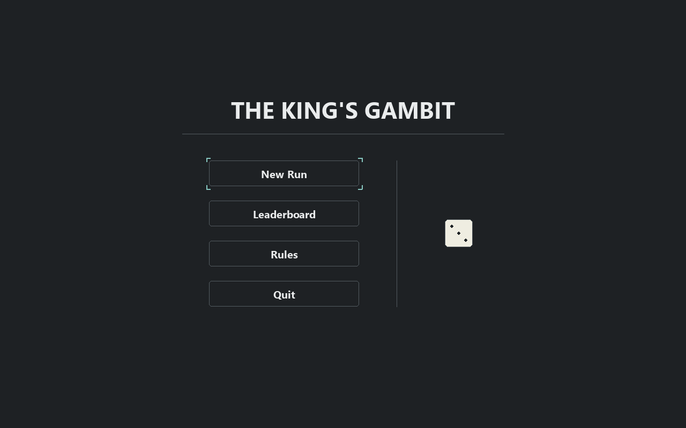
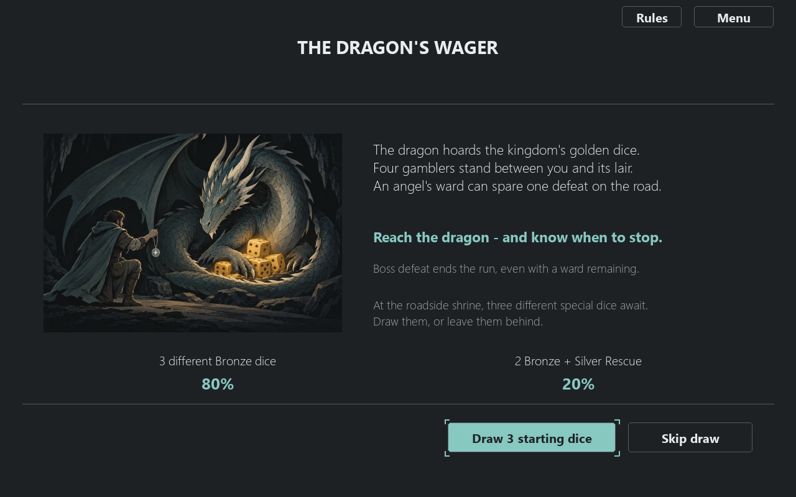
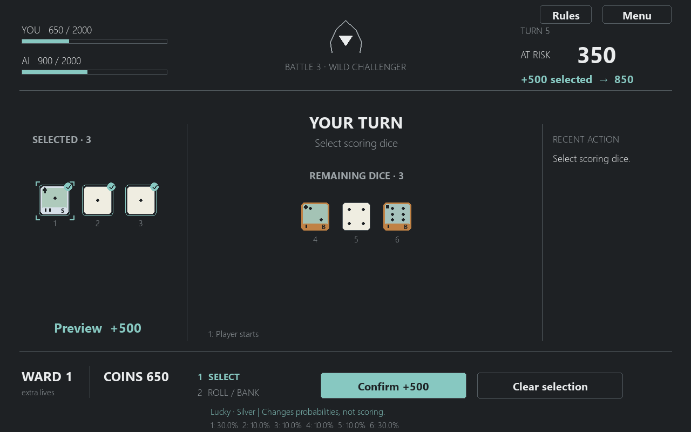
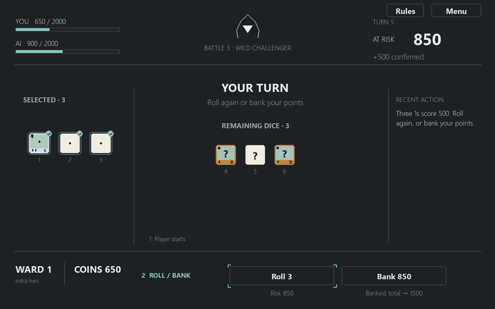
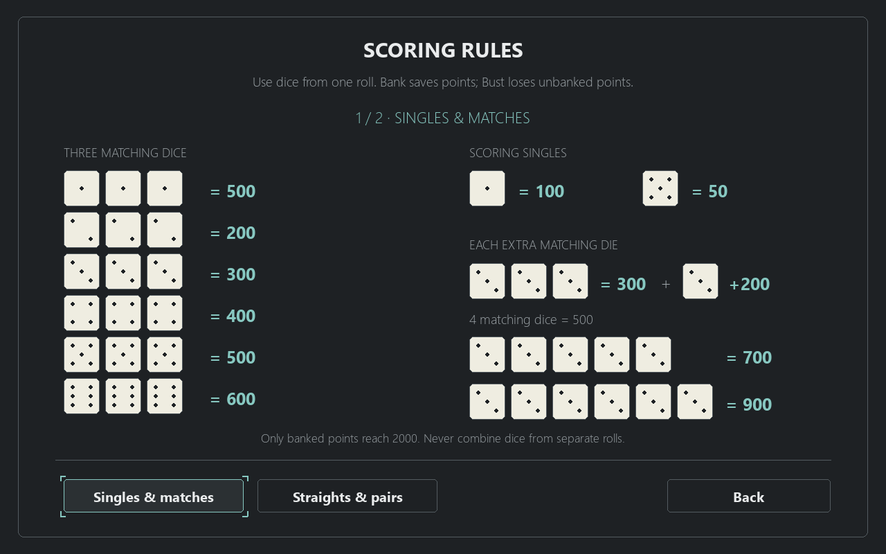

<h1 align="center">The King's Gambit</h1>

<p align="center">
  
</p>

<p align="center">
  <strong>Roll or bank? Take your chances in a medieval roguelite adventure.</strong><br>
  继续掷骰，还是收手入账？来一场中世纪风格的 Roguelite 冒险。
</p>

<p align="center">Choose a language to expand below · 点击下方语言，在当前页面展开阅读</p>

<div align="center">

<details>
<summary><strong>English</strong></summary>
<div align="left">

## Get the game

**With Git** — open a terminal and run:

```bash
git clone https://github.com/jinxwu2026-ship-it/dice_game.git
cd dice_game
```

**Without Git** — [download the ZIP](https://github.com/jinxwu2026-ship-it/dice_game/archive/refs/heads/main.zip),
or open the [repository](https://github.com/jinxwu2026-ship-it/dice_game) and choose
**Code → Download ZIP**. Extract the ZIP, then open a terminal inside `dice_game-main`.

Before continuing, make sure the current folder contains `main.py`,
`requirements-gui.txt`, `the_kings_gambit/` and `assets/`. Keep these files together.

## Install and run

Install **Python 3.10 or newer** (tested with Python 3.12.10).
The window version uses **pygame-ce 2.5.8**; the commands below install it in a
local environment without needing to activate that environment.

### Windows · PowerShell

```powershell
python -m venv .venv
.\.venv\Scripts\python.exe -m pip install -r requirements-gui.txt
.\.venv\Scripts\python.exe main.py --gui
```

If Windows cannot find `python`, use `py` for the first command.
After the first installation, run only the last line to play again.

### macOS / Linux

```bash
python3 -m venv .venv
./.venv/bin/python -m pip install -r requirements-gui.txt
./.venv/bin/python main.py --gui
```

These are the standard commands for those platforms; actual macOS/Linux desktop
play has not yet been verified. Linux needs Python's `venv` module installed.
The window version needs a local desktop display and does not run in Ed's execution environment.

## Your first run

### 1 · Enter the adventure

Choose **New Run**. Four gamblers stand between you and the dragon's hoard.
**Rules** explains scoring with dice pictures; **Leaderboard** shows completed local runs.

<p align="center">
  
</p>

### 2 · Pick your starting dice

Choose **Draw 3 starting dice**, then keep or decline each gift and select a slot
for any die you keep. **Skip draw** starts with ordinary dice instead.
At the wager screen, a **0-coin bet** is allowed; confirm the wager to begin.

<p align="center">
  
</p>

### 3 · Select a scoring combination

Click dice to move them into the left tray; click again to undo.
**Clear selection** resets the preview. **Confirm +N** commits a legal selection.
In this example, three 1s are worth **500**: adding them to **350 at risk** gives **850**.

<p align="center">
  
</p>

### 4 · Roll or bank?

After confirming, choose **Roll 3** to throw the three remaining dice, or
**Bank 850** to secure the turn's points. Here, banking raises your match score
from **650 to 1500**. A Bust instead loses the **850 at risk**, leaving the banked **650** safe.
Bank and Bust show their result briefly, then advance automatically.

<p align="center">
  
</p>

The screenshots above are rendered from the current interface with a controlled
example; the selection and decision pictures show the same turn.

## Rules at a glance

- Each battle is a race to **2000 banked points**. Unbanked points cannot win.
- A turn starts with six dice. Select scoring dice from the current roll, then bank or roll the remainder.
- A **Bust** loses this turn's unbanked points. Previously banked points stay safe.
- **Hot Dice** restores all six dice after all six have scored; accumulated points remain at risk.
- Ordinary three pairs can explicitly reroll all six for **+0**, preserving earlier turn points.
- Never form a combination using dice from different rolls.

Open **Rules** from the main menu or during play for both illustrated pages.
Closing the in-game reference preserves your pending selection.

<p align="center">
  
</p>

## What is in a run?

Five fixed battles: **Easy → Conservative → Aggressive → Neutral elite → Composite Boss**.
Each battle starts with fresh scores and a fair 0/1 roll for the first player.
Coins and equipment carry over. Guessing, a spinner, rewards and a shop appear along the route.

You start with **100 coins** and **1 WARD**, an extra life. Losing one of the first
four battles consumes the ward and advances you to the next battle. With no ward,
a further loss ends the run. Losing to the Boss always ends it; defeating the Boss wins.
Boss victory offers at least one Gold die, without duplicating an already won Gold stake.

Special dice include **Lucky / Two / Odd / Even** for biased faces,
**Devil / Angel** for restricted wildcards, **Momentum** for a bonus built through
successful scoring selections, and **Rescue** for an optional once-per-battle
reroll of the remaining pool while that die is still available.
Hover or focus a die to see its effect and actual face probabilities.

Completed runs receive a seven-part performance score. **Leaderboard** reads
finished local victory/defeat records from `match_logs/*.txt`; quits and incomplete
records do not rank. There are no online accounts or permanent gameplay upgrades.

## Controls and local records

| Action | Input |
|---|---|
| Select or deselect a die | Click, or press 1–6 |
| Move keyboard focus | Tab / Shift+Tab or arrow keys |
| Activate the focused control | Enter / Space |
| Read scoring rules | Rules button in the menu or during play |
| Close an overlay / request exit | Escape; leaving a run requires confirmation |
| Reveal an animation's result immediately | Skip animation; the result does not change |

The game interface is **English**; these language sections translate the guide.
Actual runs create timestamped UTF-8 `.txt` records in `match_logs/`.
Records stay on your computer and are ignored by Git. Quitting ends the current run;
there is no mid-run save/resume. Music is not included in this version.

## Terminal option

The complete five-battle run also works with the Python standard library alone:

```powershell
python main.py --run
```

On macOS/Linux use `python3`. Enter dice positions such as `1 3 5`, then `R` to roll
or `B` to bank. Press Enter after completed turns; `Q` quits.
Use `--ascii` if special symbols do not display correctly, or `--ai-delay 0` to remove AI reading pauses.

The shared rules live in `scoring.py`, `models.py` and `battle.py`;
`progression.py` controls the five-battle run. The optional GUI is in `gui.py` and
`gui_session.py`, and `requirements-gui.txt` lists its dependency.
Design notes, tests, analysis tools and personal histories stay in the local
development workspace; the public repository includes only runtime files,
README illustrations, guides and dependencies.

</div>
</details>

<details>
<summary><strong>简体中文</strong></summary>
<div align="left">

## 获取游戏

**使用 Git**：打开终端并执行：

```bash
git clone https://github.com/jinxwu2026-ship-it/dice_game.git
cd dice_game
```

**不使用 Git**：直接[下载 ZIP](https://github.com/jinxwu2026-ship-it/dice_game/archive/refs/heads/main.zip)，
或进入[项目主页](https://github.com/jinxwu2026-ship-it/dice_game)，选择 **Code → Download ZIP**。
解压后，在 `dice_game-main` 文件夹中打开终端。

继续之前，确认当前文件夹包含 `main.py`、`requirements-gui.txt`、`the_kings_gambit/` 和 `assets/`。
请将这些文件保留在一起。

## 安装依赖并运行

安装 **Python 3.10 或更新版本**，当前验证环境为 Python 3.12.10。
窗口版需要 **pygame-ce 2.5.8**。下面的命令会创建本地虚拟环境并安装依赖，无需手动激活环境。

### Windows · PowerShell

```powershell
python -m venv .venv
.\.venv\Scripts\python.exe -m pip install -r requirements-gui.txt
.\.venv\Scripts\python.exe main.py --gui
```

如果 Windows 找不到 `python`，第一行改用 `py`。首次安装后，再次游玩只需执行最后一行。

### macOS / Linux

```bash
python3 -m venv .venv
./.venv/bin/python -m pip install -r requirements-gui.txt
./.venv/bin/python main.py --gui
```

这些是对应平台的标准命令，尚未验证 macOS/Linux 桌面的实际游玩。Linux 需要安装 Python 的 `venv` 模块。
窗口版需要本地桌面显示，不能直接在 Ed 的执行环境中运行。

## 开始你的第一场冒险

### 1 · 进入冒险

点击 **New Run**。四名赌徒挡在你与恶龙宝藏之间。
**Rules** 提供骰面图示规则，**Leaderboard** 展示已经结束的本地冒险排名。

<p align="center">
  
</p>

### 2 · 选择开局骰子

点击 **Draw 3 starting dice** 抽取三颗开局骰子，逐颗决定保留或放弃；保留时选择放置槽位。
也可选择 **Skip draw**，直接携带普通骰子开始。
进入赌注界面后，允许选择 **0 金币下注**，确认赌注即可开战。

<p align="center">
  
</p>

### 3 · 选出得分组合

点击骰子，将其移到左侧选择区；再次点击可撤回。
**Clear selection** 清空预览，**Confirm +N** 确认一个合法选择。
图中三个 1 可获得 **500 分**，加上已有的 **350 风险分**，确认后共有 **850 分**尚未入账。

<p align="center">
  
</p>

### 4 · Roll，还是 Bank？

确认后，可以选择 **Roll 3** 投掷剩余三颗骰子，或 **Bank 850** 收手保住本回合分数。
图中若入账，战斗总分从 **650 提升到 1500**；若继续投掷后 Bust，则丢失 **850 风险分**，
已经入账的 **650 分**仍然安全。
Bank 和 Bust 会短暂展示结果，然后自动切换回合。

<p align="center">
  
</p>

以上图片由当前游戏界面按受控示例渲染，选骰图和决策图展示同一个回合。

## 快速了解规则

- 每场战斗以 **入账达到 2000 分**为胜利条件，风险分不能直接获胜。
- 回合从六颗骰子开始，每次选择当前投掷中可计分的骰子，然后入账或继续掷剩余骰子。
- **Bust** 丢失本回合所有未入账分数，此前已入账的分数不受影响。
- **Hot Dice**：六颗骰子全部计分后恢复六颗可掷骰子，累计分数继续承担风险。
- 普通三对可以明确选择六颗，以 **+0** 全部重掷，并保留此前风险分。
- 不可使用不同次投掷的骰子拼成组合。

主菜单和游玩界面的 **Rules** 都提供两页图示规则；关闭游玩中的规则窗口会保留尚未确认的选择。

<p align="center">
  
</p>

## 一次冒险有什么？

固定五场战斗：**Easy → 保守 → 激进 → 中性精英 → 复合人格 Boss**。
每场双方分数归零，公平掷一次 0/1 决定先手；金币和装备跨场保留。
途中会遇到猜大小、转盘、奖励和商店。

初始持有 **100 金币**和 **1 WARD**。WARD 表示额外生命：前四场中失败一次会消耗它，随后进入下一场。
WARD 为 0 仍可继续，但再输一场就结束冒险。输给 Boss 无论剩余多少 WARD 都会结束，击败 Boss 则获胜。
Boss 胜利至少提供一颗 Gold 奖励骰；如果已赢得 Gold 赌注，不重复发放。

特殊骰子包括改变骰面概率的 **Lucky / Two / Odd / Even**、受限万能面的 **Devil / Angel**、
随成功计分选择积累加分的 **Momentum**，以及实体骰子仍在可用骰池时可选发动、每场一次重掷剩余骰池的 **Rescue**。
悬停或聚焦骰子可查看效果和实际骰面概率。

冒险结束后会结算七项表现分。**Leaderboard** 从 `match_logs/*.txt` 读取已结束的本地胜利/失败记录；
退出或未完成的冒险不参与排名。没有在线账号，也没有跨局永久能力成长。

## 操作与本地记录

| 动作 | 操作 |
|---|---|
| 选择或撤回骰子 | 点击，或按 1–6 |
| 移动键盘焦点 | Tab / Shift+Tab 或方向键 |
| 激活当前控件 | Enter / Space |
| 阅读计分规则 | 主菜单或游玩界面的 Rules |
| 关闭弹窗 / 请求退出 | Escape；退出冒险需要确认 |
| 立即显示动画结果 | Skip animation，不会改变结果 |

游戏界面为**英文**，此处的语言选项只切换说明文档内容。
实际冒险会在 `match_logs/` 生成按开始时间命名的 UTF-8 `.txt` 记录，仅保存在你的电脑上，Git 会忽略它们。
退出即结束当前冒险，不支持中途存档恢复。当前版本未加入背景音乐。

## 终端运行方式

完整五场流程也可仅使用 Python 标准库运行：

```powershell
python main.py --run
```

macOS/Linux 使用 `python3`。输入 `1 3 5` 等骰子位置，然后 `R` 继续掷骰或 `B` 入账。
完整回合结束后按 Enter 继续，`Q` 退出。
特殊符号显示异常时使用 `--ascii`；`--ai-delay 0` 可取消 AI 阅读停顿。

共用规则位于 `scoring.py`、`models.py`、`battle.py`；`progression.py` 管理五场冒险。
可选窗口界面由 `gui.py` 和 `gui_session.py` 实现，依赖列于 `requirements-gui.txt`。
设计文档、测试、分析工具和个人历史仅保留在本地开发目录；公开仓库只包含运行文件、
README 插图、说明文档和依赖文件。

</div>
</details>

</div>
